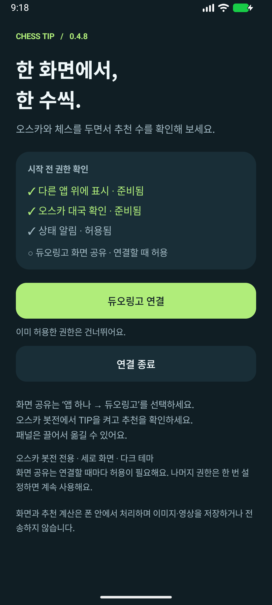
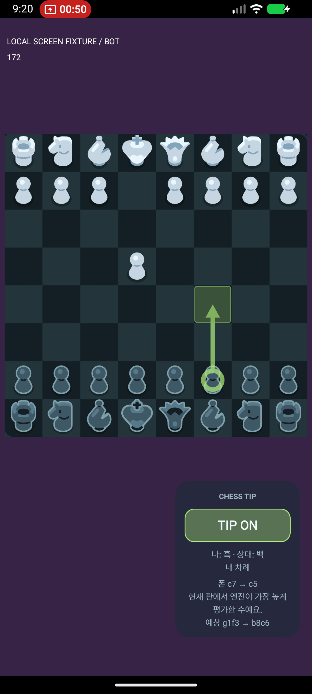
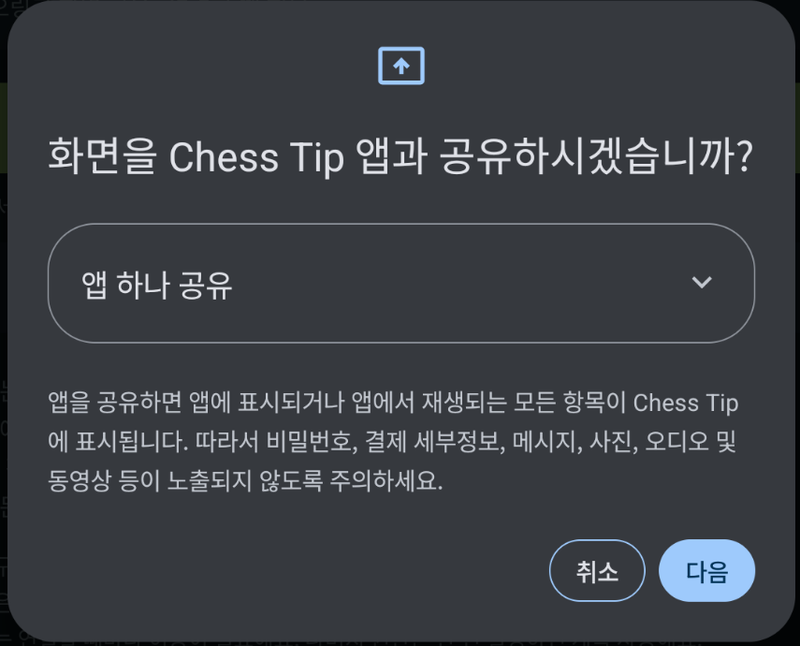
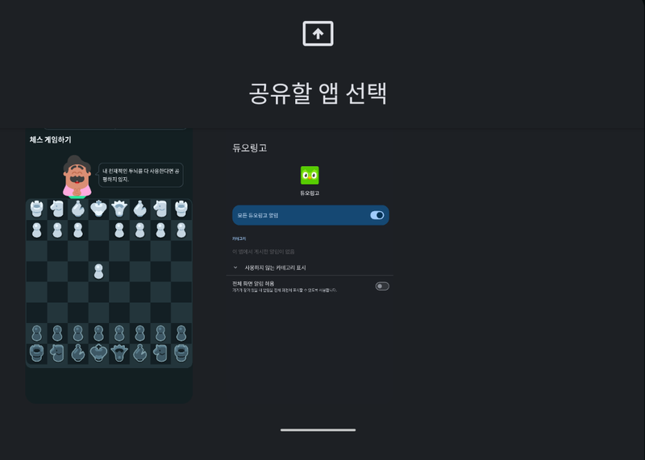

# Chess Tip

듀오링고 **오스카 봇전 전용 Android 체스 코치**입니다. Stockfish 추천 수를 체스판 위에 표시합니다. 화살표와 짧은 설명을 보고 직접 기물을 두며 연습할 수 있습니다.

**Android 14 이상 · ARM64 · 한국어 UI**

[**APK 받기**](https://github.com/cozdx1/duolingo-chess-helper/releases/tag/v0.4.8)

## 화면 예시

<table>
  <tr>
    <th>권한 확인과 화면 연결</th>
    <th>추천 수 표시 (모의 체스판)</th>
  </tr>
  <tr>
    <td></td>
    <td></td>
  </tr>
</table>

## 주요 기능

- 추천 수의 출발·도착 칸을 화살표로 표시합니다. 일반 이동은 초록색, 잡는 수는 주황색으로 구분합니다.
- 잡기, 체크, 캐슬링, 기물 전개처럼 추천한 수의 특징을 한국어로 보여줍니다.
- 화면에서 체스판의 위치와 크기를 찾아 표시 좌표를 계산합니다.
- 패널을 끌어서 옮기거나 TIP 버튼으로 추천 표시를 켜고 끌 수 있습니다.

현재 열린 창이 **오스카 봇전**으로 확인된 경우에만 판을 읽습니다. 친구·랜덤 대국에 들어가면 추천 표시를 끕니다. 체스 수는 사용자가 직접 둡니다.

## 설치와 사용

1. [v0.4.8 릴리스](https://github.com/cozdx1/duolingo-chess-helper/releases/tag/v0.4.8)에서 `ChessTip-0.4.8-arm64-v8a.apk`를 내려받아 설치합니다.
2. Chess Tip을 열고 **준비하고 듀오링고 연결**을 누릅니다. 권한이 준비되어 있으면 **듀오링고 연결**로 표시됩니다.
3. 화면 공유 창에서 **앱 하나 공유 → 다음 → 듀오링고**를 선택합니다.
4. **오스카와 대결하기**를 열고 새 대국의 첫 화면에서 **TIP ON**을 켭니다. 흑이라면 백이 첫 수를 둔 직후에도 시작할 수 있습니다.

듀오링고의 **세로 화면·다크 테마**를 기준으로 동작합니다. 패널은 체스판을 가리지 않는 위치로 옮겨 주세요. 화면 연결을 끝내려면 패널 제목을 길게 누르거나 알림의 **종료**를 누릅니다.

<details>
<summary>화면 공유 예시</summary>

<table>
  <tr>
    <th>앱 하나 공유</th>
    <th>듀오링고 선택</th>
  </tr>
  <tr>
    <td></td>
    <td></td>
  </tr>
</table>

</details>

### 필요한 권한

| 권한 | 용도 |
| --- | --- |
| 다른 앱 위에 표시 | 추천 화살표와 패널 표시 |
| 화면 공유 | 선택한 듀오링고 화면에서 오스카 체스판 읽기 |
| 접근성 | 현재 열린 창이 오스카 봇전인지 확인 |
| 알림 (선택) | 연결 상태 표시와 종료 버튼 제공 |

접근성은 **설정 → 접근성 → 설치된 앱 → Chess Tip 대국 확인 → 사용**에서 켭니다. 메뉴 이름은 기기에 따라 다를 수 있습니다. 앱을 업데이트한 뒤 화면 확인 서비스가 꺼져 있으면 다시 켜 주세요. 화면 공유는 새 연결마다 허용해야 합니다.

## 화면을 읽지 못할 때

| 표시 | 확인할 내용 |
| --- | --- |
| 오스카 봇전 대기 | ‘오스카와 대결하기’를 엽니다. 이미 봇전 화면이면 새 봇전을 열어 창 종류를 확인할 수 있게 해 주세요. |
| 오스카 봇전 전용 | 친구·랜덤 대국에서는 추천 표시가 꺼집니다. |
| 판을 읽는 중 | 판을 가리는 메뉴를 닫고 기물 이동 애니메이션이 끝날 때까지 기다립니다. |
| 수순 확인 중 | 중간에 연결하면 현재 차례를 확정하기 어려울 수 있습니다. 새 대국 첫 화면에서 시작하세요. |
| 전체 화면 공유가 선택되어 있어요 | 연결을 종료하고 **앱 하나 공유 → 듀오링고**로 다시 연결합니다. |

## 화면 처리와 저장

앱은 접근성에서 현재 창 정보를 확인하고, 화면 공유에서 받은 픽셀로 체스판을 찾습니다. 연속된 프레임에서 기물 배치가 안정되고 수순이 확인되면 Stockfish가 내 차례의 수를 분석합니다. 창이 바뀌면 그 창에서 계산한 결과를 폐기합니다.

화면 인식과 엔진 계산은 기기에서 처리합니다. 앱에는 인터넷 권한이 없고 화면 이미지나 영상은 저장하지 않습니다. 재연결에 쓰는 마지막 오스카 대국 상태와 판 방향은 기기에 저장합니다.

## 개발

<details>
<summary>직접 빌드하기 · Windows</summary>

Android Studio, Android SDK Platform 36, Build Tools 36.0.0을 준비합니다. Android Studio에서 프로젝트를 열거나 PowerShell에서 아래와 같이 실행합니다.

```powershell
.\scripts\android.ps1 check
.\scripts\android.ps1 build
.\scripts\android.ps1 install
.\scripts\android.ps1 launch
```

`build`는 디버그 APK 빌드와 Android Lint, 단위 테스트를 실행합니다. APK는 `app/build/outputs/apk/debug/app-debug.apk`에 생성됩니다. `install`과 `launch`는 USB 디버깅으로 연결한 실제 기기용입니다.

Gradle 9.1.0과 Android Gradle Plugin 9.0.1을 사용합니다. 스크립트는 Android Studio의 JBR을 사용하며 SDK는 `ANDROID_HOME` 또는 기본 위치에서 찾습니다. 엔진 바이너리가 포함되어 있어 앱만 빌드할 때는 NDK가 필요하지 않습니다.

v0.4.8에서 단위 테스트 24개를 통과했습니다. Android 에뮬레이터에 같은 모의 체스판을 두 대국 창으로 띄워, 오스카 창에서만 추천을 표시하는지 확인했습니다.

</details>

<details>
<summary>배포용 APK 만들기 · Windows</summary>

배포용 키 저장소와 비밀번호 파일을 저장소 밖에 두고 실행합니다. 키 별칭의 기본값은 `chess-tip`이며, 키와 키 저장소의 비밀번호를 같게 설정합니다. 업데이트에는 같은 배포 키를 사용합니다. [Android 앱 서명 안내](https://developer.android.com/studio/publish/app-signing)

```powershell
.\scripts\release.ps1 -KeyStore 'C:\keys\chess-tip-release.p12' -PasswordFile 'C:\keys\chess-tip-release.password'
```

스크립트는 Release 빌드·Lint·단위 테스트를 실행하고 APK 정렬과 서명을 검증합니다. APK와 체크섬은 `artifacts/release-<버전>/`에 생성됩니다.

</details>

<details>
<summary>엔진 설정</summary>

| 항목 | 설정 |
| --- | --- |
| 엔진 | Stockfish 19 |
| 계산 시간 | 한 수당 약 1초 |
| 스레드 | 2 |
| 해시 메모리 | 32 MiB |
| Skill Level | 20 |
| 강도 제한 | 해제 |

탐색 깊이는 판의 복잡도와 기기 성능에 따라 달라집니다.

</details>

## 사용한 오픈소스

- **Stockfish 19** · GPL-3.0-or-later ([라이선스](third_party/stockfish/Copying.txt) · [출처와 재빌드 안내](third_party/stockfish/SOURCE.md))
- **chesslib 1.3.7** · Apache-2.0 ([라이선스](app/src/main/assets/licenses/chesslib-Apache-2.0.txt))

라이선스 원문은 APK의 `assets/licenses/`에도 포함되어 있습니다. Chess Tip은 비공식 개인 프로젝트입니다.
