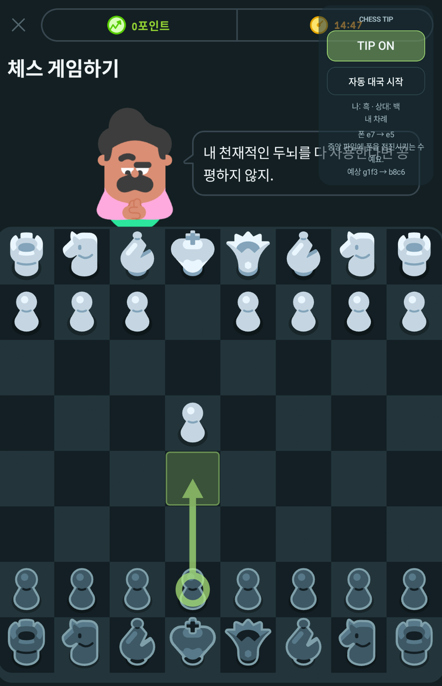
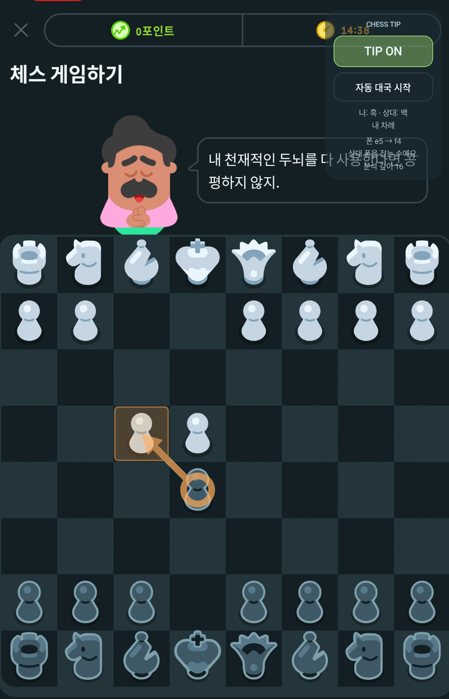
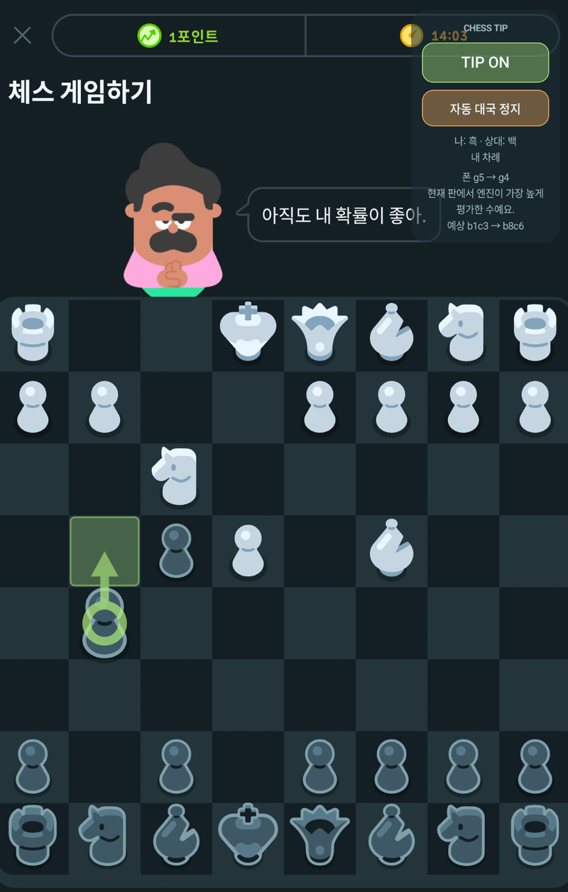
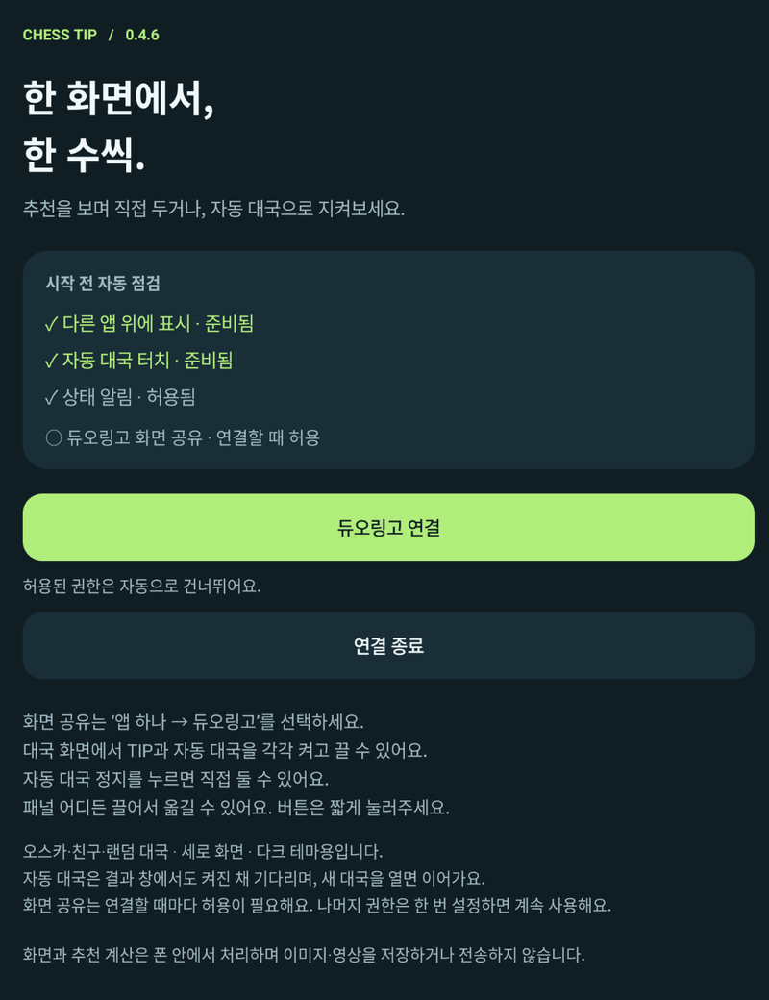
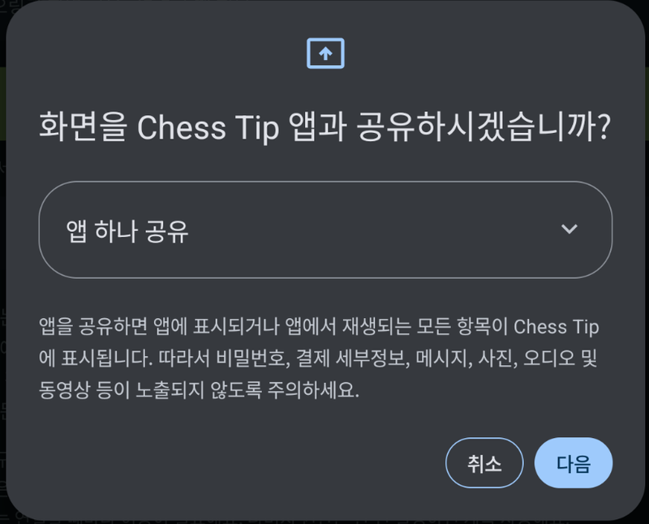
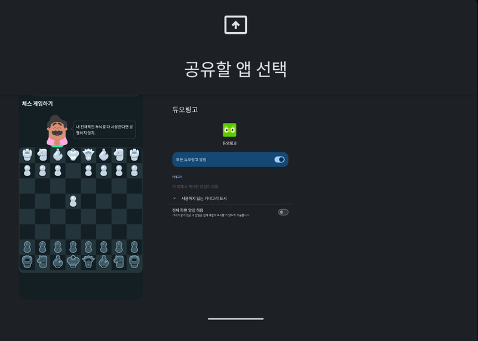

# Chess Tip

듀오링고 체스를 위한 **Android 보조 앱**입니다. Stockfish가 계산한 추천 수를 체스판 위에 표시하고, 직접 수를 두거나 자동 대국을 지켜볼 수 있습니다.

듀오링고에서 체스를 두면서 좋은 수를 바로 확인하려고 만들었습니다. 듀오링고와 함께 실행하는 별도 앱으로, 비공식 개인 프로젝트입니다.

**Android 14 이상 · ARM64 · 한국어 UI · 현재 버전 0.4.6**

## 화면 예시

<table>
  <tr>
    <th>일반 이동</th>
    <th>잡는 수</th>
    <th>자동 대국</th>
  </tr>
  <tr>
    <td></td>
    <td></td>
    <td></td>
  </tr>
</table>

## 주요 기능

- **추천 수 표시:** 출발 칸과 도착 칸을 화살표로 연결합니다. 일반 이동은 초록색, 잡는 수는 주황색으로 구분합니다.
- **짧은 설명:** 잡기·체크·캐슬링·기물 전개 등 추천 수의 특징을 한국어로 보여줍니다.
- **자동 대국:** 내 차례의 추천 수를 자동으로 입력합니다. 시작·정지 버튼으로 직접 두기와 관전을 전환할 수 있습니다.
- **이동 가능한 오버레이:** 반투명 패널 어디든 끌어서 위치를 바꿀 수 있습니다. TIP 버튼으로 추천 표시를 켜고 끕니다.
- **판 크기에 맞춘 좌표 계산:** 화면에서 실제 체스판의 위치와 칸 크기를 찾아 추천 표시와 터치 좌표를 계산합니다.
- **기기 안에서 분석:** 화면 인식과 Stockfish 계산을 모두 기기에서 처리합니다.

추천은 한 수당 약 1초 동안 계산한 결과입니다. 설명은 수의 특징을 알려주며, 긴 전략 해설을 생성하는 기능은 없습니다.

## 지원 환경

| 항목 | 범위 |
| --- | --- |
| 운영체제 | Android 14 이상 |
| CPU | ARM64 |
| 앱 언어 | 한국어 |
| 듀오링고 화면 | 세로 화면·다크 테마, 오스카·친구·랜덤 대국 |
| 실기 확인 | Galaxy S23 Ultra / Android 16 |
| 에뮬레이터 확인 | MuMu / Android 15 / 1440×2560·DPI 360 |

**iOS는 지원하지 않습니다.** MuMu에서는 ARM64 번역 기능으로 실행을 확인했습니다. 다른 테마와 가로·분할 화면의 실제 동작은 검증하지 않았습니다. 듀오링고의 화면 구성이 바뀌면 인식 수정이 필요할 수 있습니다.

## 설치와 사용

1. Android 기기에 **Chess Tip APK**를 설치합니다. 직접 빌드하는 방법은 아래에 있습니다.
2. Chess Tip을 열고 **준비하고 듀오링고 연결**을 누릅니다. 이미 권한이 준비되어 있으면 **듀오링고 연결**로 표시됩니다.
3. 안내에 따라 필요한 권한을 허용하고 앱으로 돌아옵니다.
4. 화면 공유 창에서 **앱 하나 공유 → 다음 → 듀오링고**를 선택합니다.
5. 새 대국의 첫 화면에서 시작합니다. 흑이라면 백이 첫 수를 둔 화면에서도 시작할 수 있습니다.
6. **TIP ON**으로 추천을 보거나, **자동 대국 시작**을 눌러 관전합니다.

패널은 체스판을 가리지 않는 곳에 두세요. 패널 어디든 드래그해 옮길 수 있습니다.

**TIP OFF는 추천 표시만 끕니다. 자동 대국을 멈추려면 ‘자동 대국 정지’를 누르세요.** 화면 연결까지 끝내려면 앱의 **연결 종료** 또는 알림의 **종료**를 누릅니다.

<details>
<summary>연결 화면 보기</summary>

<table>
  <tr>
    <th>시작 전 권한 점검</th>
    <th>앱 하나 공유</th>
    <th>듀오링고 선택</th>
  </tr>
  <tr>
    <td></td>
    <td></td>
    <td></td>
  </tr>
</table>

</details>

### 필요한 권한

| 권한 | 용도 |
| --- | --- |
| 다른 앱 위에 표시 | 추천 화살표와 조작 패널 표시 |
| 화면 공유 | 선택한 듀오링고 화면에서 체스판 읽기 |
| 접근성 | 자동 대국의 기물 선택·이동 입력. 추천만 쓸 때는 선택 사항 |
| 알림 | 연결 상태 표시와 종료 버튼 제공. 허용하지 않아도 연결 가능 |

접근성은 **설정 → 접근성 → 설치된 앱 → Chess Tip 자동 대국 → 사용**에서 켭니다. 메뉴 이름은 기기에 따라 다를 수 있습니다. 추천만 쓰려면 시작 화면의 **Tip만 연결하기**를 사용할 수 있습니다.

화면 공유는 새로 연결할 때마다 허용해야 합니다. 앱 업데이트나 화면 잠금 등으로 공유가 끝났다면 다시 연결하세요.

## 화면을 읽지 못할 때

| 표시 | 확인할 내용 |
| --- | --- |
| 판을 읽는 중 | 판을 가리는 메뉴를 닫고, 기물 이동 애니메이션이 끝날 때까지 기다립니다. |
| 수순 확인 중 | 처음 보는 중간 판은 차례 등을 확정하기 어렵습니다. 새 대국 첫 화면에서 시작합니다. |
| 전체 화면 공유가 선택되어 있어요 | 연결을 종료하고 **앱 하나 공유 → 듀오링고**로 다시 연결합니다. |
| 자동 대국 · 확인 대기 | 판이나 이동 반영 상태를 다시 확인하는 중입니다. 자동 모드는 유지하며, 조건이 확인되면 이어갑니다. |

자동 대국은 결과 창에서도 켜진 채 기다립니다. 다음 대국을 직접 열면 새 판이 확인된 뒤 이어집니다. 다음 대국을 시작하는 버튼까지 대신 누르지는 않습니다.

기물 선택 상태와 일시적인 판독 실패를 처리하지만, 판을 확실하게 읽지 못하는 동안에는 자동 입력을 보류합니다.

## 화면 처리와 저장

앱에는 인터넷 권한이 없으며, 캡처한 이미지나 영상을 저장하거나 전송하지 않습니다. 재연결에 사용하기 위해 마지막으로 확인한 대국 상태와 판 방향을 기기에 저장합니다.

화면 공유와 판 인식이 계속 실행되므로, 사용을 마쳤다면 **연결 종료**로 끝내 주세요.

## 개발

<details>
<summary>직접 빌드하기 · Windows</summary>

Android Studio와 Android SDK Platform 36, Build Tools 36.0.0을 준비합니다. Android Studio로 이 프로젝트를 열거나 PowerShell에서 실행합니다.

```powershell
.\scripts\android.ps1 check
.\scripts\android.ps1 build
.\scripts\android.ps1 install
.\scripts\android.ps1 launch
```

`build`는 APK 빌드·Android Lint·단위 테스트를 실행합니다. APK는 `app/build/outputs/apk/debug/app-debug.apk`에 생성됩니다. `install`과 `launch`는 USB 디버깅으로 연결한 실제 기기용입니다.

Gradle 9.1.0과 Android Gradle Plugin 9.0.1을 사용합니다. 스크립트는 Android Studio의 JBR을 사용하며 SDK는 `ANDROID_HOME` 또는 기본 SDK 설치 경로에서 찾습니다. 번들 엔진이 포함되어 있어 일반 앱 빌드에는 NDK를 추가로 설치할 필요가 없습니다.

0.4.6 기준 빌드·Lint·단위 테스트 47개를 통과했습니다. Lint 경고 8개가 남아 있습니다. 실제 MuMu 대국에서 자동 이동 20수와 상대의 응수, 잡기·캐슬링, 판독 실패 후 복구를 확인했습니다. HD·4K 크기로 변환한 이미지의 회귀 테스트도 통과했으며, 실제 4K 설정에서의 대국은 검증하지 않았습니다.

</details>

<details>
<summary>현재 엔진 설정</summary>

| 항목 | 설정 |
| --- | --- |
| 엔진 | Stockfish 19 |
| 계산 시간 | 한 수당 약 1초 |
| 스레드 | 2 |
| 해시 메모리 | 32 MiB |
| Skill Level | 20 |
| 강도 제한 | 해제 |

탐색 깊이는 고정하지 않습니다. 기기 성능과 판의 복잡도에 따라 계산 깊이가 달라집니다.

</details>

## 사용한 오픈소스

- **Stockfish 19** — GPL-3.0-or-later. [라이선스](third_party/stockfish/Copying.txt) · [출처와 재빌드 방법](third_party/stockfish/SOURCE.md)
- **chesslib 1.3.7** — Apache-2.0. [라이선스](app/src/main/assets/licenses/chesslib-Apache-2.0.txt)

라이선스 원문은 APK의 `assets/licenses/`에도 포함되어 있습니다.
